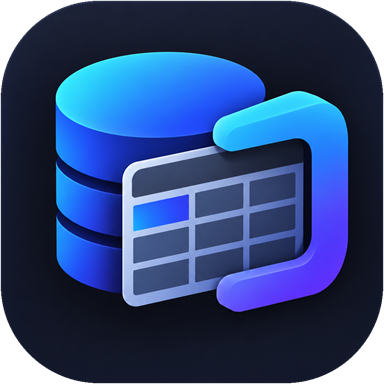

  

<h1 align="center">TableGrip</h1>

<h3 align="center">A fast, minimalist database client for macOS</h3>

  
  

#### TableGrip is a native macOS application (Swift 6, SwiftUI + AppKit) for macOS 13 and later, on Apple Silicon and Intel

TableGrip lets you browse, query and edit a database in one small window, and shows every change as SQL before it is
written. It is the macOS port of the Windows application of the same name, with the same features.

Supports **SQLite**, **MySQL**, **MariaDB** and **PostgreSQL**

> **Status:** version 1.6.3. The app is not code-signed or notarised yet, so Gatekeeper asks for confirmation the first
> time it is opened. MariaDB has not been exercised against a live server yet, and SQL Server is shown in the engine
> picker but has no driver yet.

### As excited as we are?

#### Check out some of our features:

- **One database per connection.** Pick an engine, name the database, and the sidebar shows only its tables and views.
- **Safe editing.** Edits are staged, shown as the exact SQL, and committed in one transaction. If one statement fails,
  nothing is saved. Undo and redo.
- **SQL editor** with highlighting, autocomplete that understands your aliases, run a statement or a script, cancel,
  history and saved queries, `:name` parameters and snippets.
- **Large tables.** Sorting, filtering and paging happen on the server; a Structure tab shows columns, keys, indexes, DDL,
  column insights and what uses the table.
- **Export** to CSV, JSON, SQL and Excel. **Import** CSV, validated completely before a single row is written.
- **Plans, diagrams, comparing.** Explain a statement step by step, draw the ER diagram, compare two tables and get the
  script that would make one match the other.
- **Careful with servers.** SSH tunnels, TLS from "if offered" to "verify identity", safe mode per connection
  (confirm changes or read-only), and a production lock that asks for the connection's name.
- **Quiet and accessible.** Light, dark or classic themes, a command palette (⌘K), keyboard reachable controls.
- **Private.** No account, no telemetry. The update check only contacts the release page (and can be turned off).

### Learn more

- [User guide](docs/user-guide.md): connections, SSH and TLS, safe mode, editing, shortcuts
- [Release notes](https://github.com/Apizr00/tablegrip-macos-releases/releases): what changed in each version

### Feedback

Found a bug or want a feature? Please [open an issue](https://github.com/Apizr00/tablegrip-macos-releases/issues).

TableGrip is free to use under the [MIT License](LICENSE). The source code is not public. The open-source components it is
built on are listed in [THIRD-PARTY-NOTICES.md](THIRD-PARTY-NOTICES.md).

 

<h3 align="center">TableGrip is free and well maintained by <a href="https://github.com/Apizr00">Hafiz Rodzli</a></h3>

TableGrip Team | <a href="https://github.com/Apizr00">Hafiz Rodzli</a>

